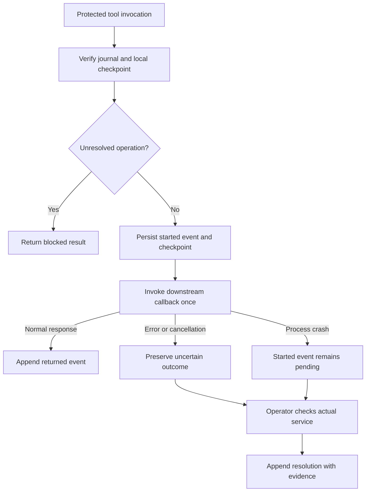

# Hermes Crash Recovery

A native Hermes Agent plugin that journals protected tool invocations before dispatch and blocks further protected work when an earlier outcome is unresolved. The journal uses a SHA-256 hash chain and a separate local checkpoint to detect inconsistent or modified history.

The recovery gate is **profile-wide**: restarting Hermes, opening a new session, changing arguments, or switching tools does not release a pending operation. An operator must reconcile the outcome using independent evidence.

[CI](https://github.com/sammy-XXIV/hermes-crash-recovery/actions/workflows/tests.yml) · [Native demo evidence](docs/native-demo/README.md) · [Verification report](docs/verification.md) · [Catalog PR](https://github.com/NousResearch/hermes-agent/pull/153183)

## Execution contract

| Condition | Behavior |
|---|---|
| Valid journal; no unresolved operation | Persist execution intent, then invoke the downstream callback once |
| Normal tool response | Append a `returned` event and release the gate |
| Exception, cancellation, or recognized error response | Preserve an uncertain outcome; refuse further protected calls |
| Process terminates before a terminal event is recorded | The durable `started` record remains pending after restart |
| Pending or uncertain operation exists | Refuse protected calls across the entire active profile |
| Journal or checkpoint verification fails | Refuse protected calls without invoking their downstream callback |
| Recording fails after downstream execution | Report an unknown outcome and block further protected calls in that guard instance |
| Operator reconciles an operation | Append a resolution event; allow subsequent normal calls |

This is a conservative recovery mechanism. It does not automatically replay work, deduplicate intentionally repeated completed calls, or establish exactly-once execution in an external service. A tool response and an externally verified business outcome are different facts.

## Requirements and installation

- Hermes Agent **0.23.1 or newer**.
- Python **3.11 or newer** for the standalone demo and operator utilities.
- Local storage with reliable SQLite locking and filesystem replacement semantics.
- No additional Python dependencies, API keys, hosted services, or model calls in the runtime plugin.

Install the public repository and enable the plugin:

```console
hermes plugins install sammy-XXIV/hermes-crash-recovery
hermes plugins enable crash-recovery
hermes plugins doctor crash-recovery --ci
```

Restart Hermes and confirm that `crash_recovery_status` and `crash_recovery_verify` are registered. A disabled or unloaded plugin provides no protection. Catalog installation by the short name depends on maintainer acceptance of the catalog PR; repository installation is available independently.

For local development, place a checkout in the active profile's `plugins/crash-recovery/` directory. Runtime state belongs to that profile's `plugin-data/crash-recovery/` directory and survives plugin updates or removal.

## Architecture

| Component | Responsibility |
|---|---|
| [`__init__.py`](__init__.py) | Register middleware, the pre-tool hook, inspection tools, and configuration |
| [`RecoveryGuard`](recovery.py) | Enforce admission, invoke downstream execution, classify responses, and preserve uncertainty |
| [`Journal`](recovery.py) | Serialize admission, append events, reconstruct operation state, and verify integrity |
| [`operator_cli.py`](operator_cli.py) | Inspect, export checkpoints, and append operator reconciliation decisions |
| [`plugin.yaml`](plugin.yaml) | Declare the compatibility floor, configuration, tools, hook, and middleware |

The runtime uses documented Hermes extension surfaces: `ctx.register_middleware`, `ctx.register_hook`, `ctx.register_tool`, `ctx.get_config`, and `plugin_data_dir`. It does not replace core functions, override tools, inspect credential stores, or modify Hermes source.



### Hook ordering and admission identity

Hermes can place `pre_tool_call` inside `tool_execution` middleware. Recording intent before calling `next_call` would otherwise cause the hook to block its own admitted operation.

The guard binds a `ContextVar` containing the admitted operation UUID and the tuple `(tool_name, session_id, tool_call_id, argument_digest)`. After verifying journal integrity, the hook may exclude only that operation from its unresolved-operation check when the current execution context and tuple match. Matching IDs from another execution context do not bypass recovery. The binding is reset in `finally` on return, exception, or cancellation.

The downstream pipeline may still contain approvals or guardrails. Consequently, `started` means entry into protected execution, not proof that the tool handler ran. An approval rejection can conservatively leave an uncertain record requiring reconciliation.

### Handling Hermes middleware failures

Hermes execution middleware can fail open when a callback raises before calling `next_call`. The guard therefore converts journal access, integrity, and admission failures into an explicit blocked result instead of throwing them into the middleware dispatcher.

Downstream exceptions retain their original propagation behavior after a best-effort uncertainty record. If post-execution persistence fails, the guard returns `crash_recovery_record_failed` with `outcome_unknown: true` and sets an in-memory poison flag. The durable pending record or checkpoint inconsistency remains available for investigation after restart. The guard never invokes the downstream callback again to recover from a recording failure.

## Journal format

The profile-local data layout is:

```text
HERMES_HOME/plugin-data/crash-recovery/
├── journal.sqlite3
├── journal.sqlite3-wal    # when present
├── journal.sqlite3-shm    # when present
├── head.json
└── initialized
```

SQLite stores the following tables:

```sql
CREATE TABLE metadata (
    key TEXT PRIMARY KEY,
    value TEXT NOT NULL
);

CREATE TABLE events (
    seq INTEGER PRIMARY KEY,
    payload TEXT NOT NULL,
    previous TEXT NOT NULL,
    hash TEXT NOT NULL
);
```

`metadata` contains a journal UUID and schema identifier, `hermes.crash-recovery.v1`. The application appends events and reconstructs state from their history; the SQLite file itself is not immutable storage.

Every payload contains `schema`, `timestamp_ns`, `kind`, and `operation_id`. Event-specific fields are:

| Event | Additional fields | Reconstructed state |
|---|---|---|
| `started` | `tool`, `fingerprint`, `args_hash`, `session_id`, `tool_call_id` | `pending` |
| `returned` | `result_hash`, `reason` | `returned` |
| `uncertain` | `result_hash`, `reason` | `uncertain` |
| `resolved` | `outcome`, `evidence` | `resolved` |

Only `pending` and `uncertain` operations hold the gate closed. A resolution's `outcome` is either `completed` or `not_applied`. Already closed operations cannot be resolved a second time through the journal API.

### Canonical encoding and hashes

Let `C(x)` be UTF-8 JSON produced by:

```python
json.dumps(x, sort_keys=True, separators=(",", ":"),
           ensure_ascii=False, allow_nan=False)
```

The genesis hash binds the journal identity:

```text
H0 = SHA256(C({"schema": SCHEMA, "journal_id": JOURNAL_UUID}))
```

For each event, `payload` is a canonical JSON **string**, and its hash is:

```text
Hi = SHA256(C({"previous": H(i-1), "payload": payload}))
```

The `started` event also records `args_hash = SHA256(C(args))` and `fingerprint = SHA256(C({"tool": tool_name, "args": args}))`. Fingerprints identify recorded inputs; they are not external-service idempotency keys or a semantic-equivalence detector.

### Transactions and checkpoint ordering

Connections use WAL mode with `synchronous=FULL`. Admission and verification acquire `BEGIN IMMEDIATE` so SQLite history and the filesystem checkpoint are observed under the same writer lock.

An append performs these operations while holding that lock:

1. Verify the existing sequence, hash links, event transitions, and exact local checkpoint.
2. Insert the next event into the uncommitted SQLite transaction.
3. Write a new checkpoint to a temporary file, flush it, call `fsync`, and replace `head.json` with `os.replace`.
4. Commit the SQLite transaction.

The checkpoint contains `schema`, `journal_id`, `count`, and `head`; it must exactly match the current journal summary. The downstream callback starts only after the admission transaction commits. The database lock is not held while a tool runs.

The two storage files are not one atomic transaction. A crash between checkpoint replacement and SQLite commit can leave the checkpoint ahead of the database. That state deliberately blocks protected work. Existing inconsistent state is never silently reset; a surviving checkpoint, initialization marker, WAL, or SHM file also prevents recreation of a missing database.

## Configuration and concurrency

By default, the following exact names are exempt from protection:

```text
read_file
search_files
crash_recovery_status
crash_recovery_verify
```

Configure additional trusted read-only tools in the active profile's `config.yaml`:

```yaml
plugins:
  entries:
    crash-recovery:
      settings:
        read_only_tools:
          - read_file
          - search_files
          - lookup_receipt
```

The configured list replaces the `read_file` / `search_files` defaults. The two inspection tools are always exempt. Exempt tools bypass journaling entirely; do not add shells, interpreters, delegation tools, or other write-capable tools. Unknown tool names remain protected. Restart Hermes after changing settings.

V1 admits **one protected call at a time per profile**. Additional concurrent calls are refused while the first is pending; they are not queued. Nested protected calls can also be refused. A pending record may represent a currently running action, not necessarily a crashed process. The plugin does not infer safe retry from elapsed time, process age, or a timeout.

## Inspection interfaces

| Interface | Input | Result |
|---|---|---|
| `crash_recovery_status` | `{}` | Integrity status and unresolved operation metadata |
| `crash_recovery_verify` | `{}` or `{"checkpoint": {...}}` | Verified journal summary, or an integrity error |

A blocked invocation returns a JSON result containing `error: "crash_recovery_blocked"`, `blocked: true`, an explanation, and relevant `operation_ids` when available. No resolve, retry, or replay tool is registered for the model.

### Operator workflow

Run the operator utility from the repository or installed plugin directory. Supply the **active profile's** data directory:

```console
python operator_cli.py --data-dir DATA_DIRECTORY status
python operator_cli.py --data-dir DATA_DIRECTORY verify
```

To reconcile an operation:

1. Stop all workers using the profile so the original action cannot still complete.
2. Inspect independent service evidence, such as a receipt, request log, or database record.
3. Append the appropriate decision with a nonempty evidence statement.

```console
python operator_cli.py --data-dir DATA_DIRECTORY resolve OPERATION_ID --outcome completed --evidence "Stopped the original worker; service receipt 123 confirms completion"
python operator_cli.py --data-dir DATA_DIRECTORY resolve OPERATION_ID --outcome not_applied --evidence "Stopped the original worker; service request log confirms no write was applied"
```

These are alternative decisions, not commands to run consecutively on the same operation. `not_applied` permits a future normal invocation; it does not replay anything. If the outcome cannot be established, leave the operation unresolved. Reconciliation does not repair an integrity failure or erase history.

Export and retain checkpoints independently of the journal directory:

```console
python operator_cli.py --data-dir DATA_DIRECTORY checkpoint > independent-checkpoint.json
python operator_cli.py --data-dir DATA_DIRECTORY verify --checkpoint independent-checkpoint.json
```

The CLI emits JSON. It exits with code `0` when inspection or reconciliation succeeds with valid integrity, and `1` on error. `status` can exit `0` while unresolved operations remain; consumers must inspect the `unresolved` array. A supplied external checkpoint is checked as an ancestor of the current journal, while the local checkpoint must match the current head exactly.

## Error classification

Exceptions and cancellations preserve uncertainty. Returned dictionaries, or strings that decode to JSON dictionaries, are treated as error responses when they contain:

- A truthy `error` field.
- `isError: true`, `success: false`, or `ok: false`.
- `status` equal to `error`, `failed`, `cancelled`, or `unknown`.
- An integer `exit_code` other than zero.

Other responses are recorded as `returned`. Error detection does not establish whether an external side effect occurred. Unusual free-text error formats and asynchronous work continuing after a tool returns are outside the generic classifier's guarantees.

## Integrity boundary and data handling

The hash chain and exact local checkpoint detect edited records, truncation, rollback, unanchored extensions, and missing or inconsistent local state. They are not a signature, a remote attestation, or a sandbox against an actor with arbitrary filesystem authority. An actor able to rewrite both the database and checkpoint can replace local history. Complete deletion of all local state cannot be distinguished from a fresh installation.

An independently retained checkpoint can expose replacement of the prefix it commits to. Verification against an older checkpoint does not authenticate subsequent history. External checkpoints are verified only when explicitly supplied; they are not automatically enforced on admission.

Raw arguments, raw tool results, and exception messages are not persisted. The journal does persist tool names, correlation IDs, timestamps, argument/result hashes, reason labels, and operator evidence. Hashes are not encryption and predictable inputs may be guessed. IDs and evidence are stored as supplied; keep secrets out of evidence text.

All runtime persistence is local to the plugin data directory. The runtime plugin performs no network calls, shell execution, subprocess creation, credential-store reads, telemetry, or background processing. Optional demos/tests create disposable workers and databases in selected directories and deliberately terminate their own processes. The native demo additionally starts a loopback provider and isolated Hermes CLI/gateway under normal approval settings.

Full history is verified on admission and completion: verification time and reconstructed state grow with event count. There is no automatic pruning. Network filesystems and power-loss durability have not been certified.

## Demonstration and verification

Run the standalone crash scenario without installing Hermes:

```console
python demo.py
```

It commits one fictional booking, force-kills its worker before the tool response is recorded, and verifies that a restarted worker cannot repeat the action. Use `--directory NEW_DIRECTORY` to retain its files.

Run the regression suite and native checks:

```console
python -m unittest discover -s tests -v
hermes plugins doctor . --ci
hermes plugins validate . --install-deps
python tests/check_host.py --hermes-root PATH/TO/hermes-agent
python tests/native_demo.py --hermes-root PATH/TO/hermes-agent --directory PATH/TO/NEW_DEMO_DIRECTORY
```

The host checks require an interpreter containing Hermes's runtime dependencies. The native demonstration uses unmodified `hermes chat --format stream-json`, an isolated profile, a scripted localhost provider, and a fictional booking plugin. It force-kills the gateway after the booking commits, launches a new session, checks the actual refusal and read-only service results, then records operator reconciliation after stopping the workers.

Recorded native result:

```json
{
  "native_cli_crash_and_restart": true,
  "live_model": false,
  "core_patched": false,
  "bookings": 1,
  "repeat_blocked": true,
  "read_only_inspection": true,
  "integrity_ok": true,
  "unresolved_after_resolution": 0
}
```

The provider is scripted, not a live model. Its narration is not the verification source: the harness checks native tool responses and the separate service database. [Selected CLI traces](docs/native-demo/README.md) and the [verification report](docs/verification.md) include the tested Hermes commit. The 21-test suite passed in CI on Ubuntu and Windows with Python 3.11, 3.13, and 3.14.

## License

[MIT](LICENSE).
